




<a href="https://my-academy.online/"></a>
<a href="https://github.com/Interno-Platform/Interno-BackEnd"></a>
<a href="https://github.com/Moamen1589/EventX-BackEnd"></a>
<a href="https://github.com/Courses-Master/Courses-Master-Backend"></a>
<a href="https://movie-app-opal-one.vercel.app/"></a>
<a href="https://github.com/Moamen1589?tab=repositories"></a>


<a href="https://drive.google.com/file/d/17gi5piShSA2p0R97FmK6UzlWsQOPO7re/view?usp=sharing"></a>
<a href="https://www.hackerrank.com/certificates/8eb338b7ca16"></a>
<a href="https://www.hackerrank.com/certificates/73a51b6ad8d6"></a>
<a href="https://drive.google.com/file/d/1Eoqc1EVO7pWM4et0VaqmHqpOWHcTRudY/view?usp=drive_link"></a>
<a href="https://drive.google.com/file/d/1Pm38KG3-SaEiVKSdI0JnJD6GInW-XyCo/view?usp=drive_link"></a>

